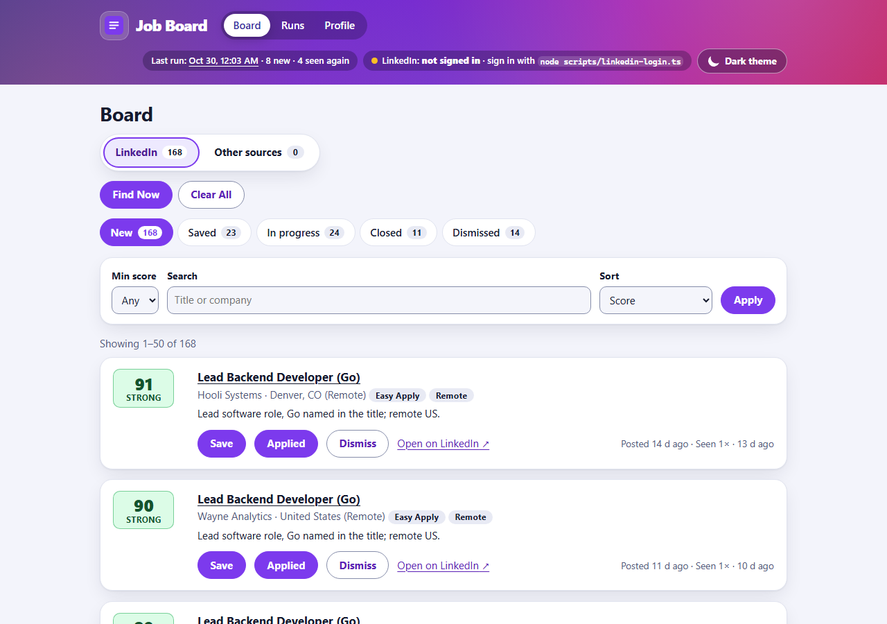
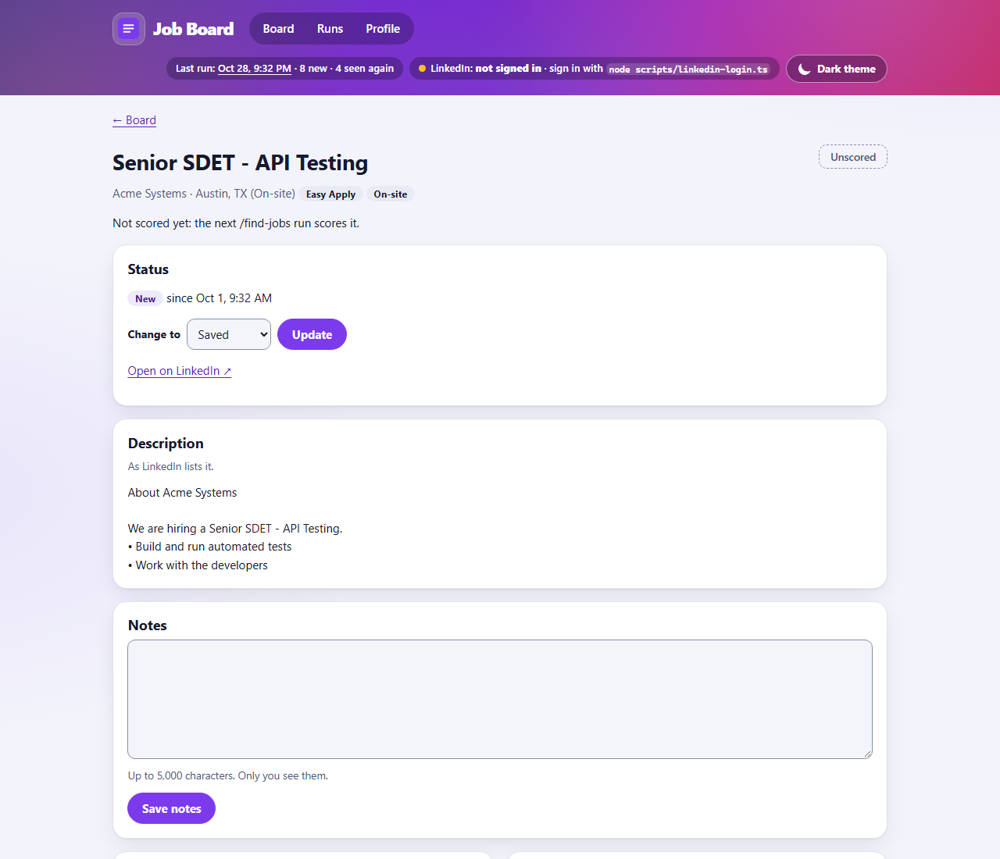
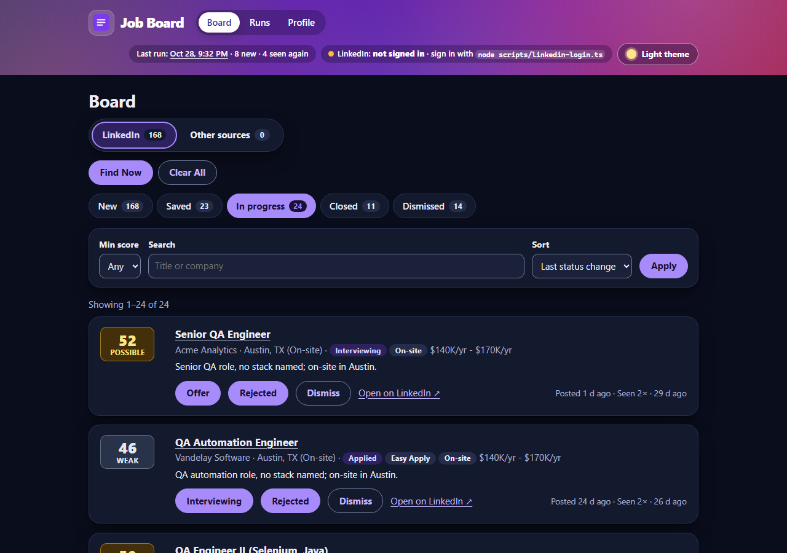
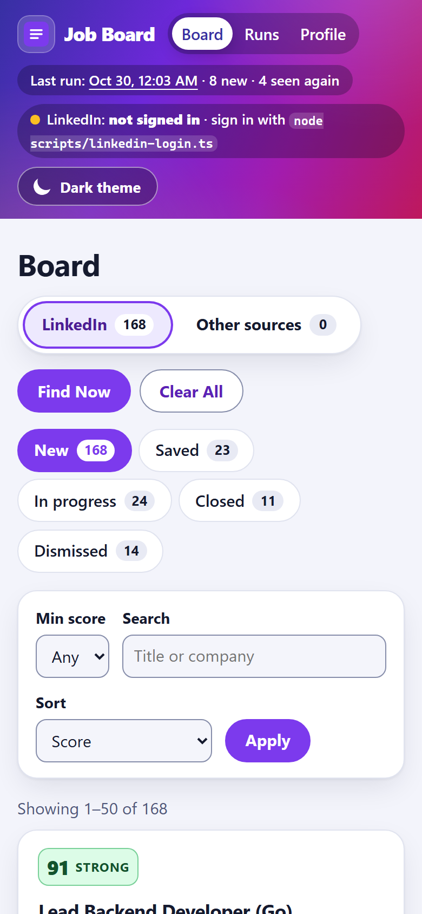

# Agentic Job Board

[](https://github.com/orhunakkan/agentic-job-board/actions/workflows/ci.yml)

A private, localhost-only command center for one person's LinkedIn job hunt, and a testing-pyramid showcase.

Running **`/find-jobs`** in Claude Code runs the owner's own LinkedIn searches with their saved LinkedIn session, limited to jobs posted since the last run, and reads each new job's full page. The same run reads free public job feeds (company job boards, remote job boards, Hacker News "Who is hiring?"), and the board shows those jobs on a view of their own. The app deduplicates and stores the jobs with deterministic, tested code, and Claude scores each new job from 0 to 100 against the owner's profile, on its full description, with a one-line reason. The board at http://127.0.0.1:3000 ranks the jobs by fit and tracks each one: saved → applied → interviewing → offer or rejected, plus notes.

[`PLAN.md`](PLAN.md) is the full plan and the source of truth.



| Job detail                                                                                    | Dark mode, In progress tab                                                  | Phone (390 px)                                                          |
| --------------------------------------------------------------------------------------------- | --------------------------------------------------------------------------- | ----------------------------------------------------------------------- |
|  |  |  |

Screenshots are taken with Playwright from fake data (`node scripts/screenshots.ts`); no real job or person appears in them.

## How it works

```
/find-jobs (Claude Code)                          App (Node 24, TypeScript, 127.0.0.1 only)
  1. GET  /api/health
  2. POST /api/runs              ───────────────►  start a run
  3. node scripts/search-linkedin.ts --run <id>
       runs the LinkedIn searches in a hidden browser with the saved session
     GET  /api/ingest/state      ───────────────►  when LinkedIn was last searched
     POST /api/listings/known    ───────────────►  which jobs are new (only their pages are read)
     POST /api/runs/:id/listings ───────────────►  deduplicate by source and job ID, store
  4. node scripts/fetch-sources.ts --run <id>
       reads the free job feeds, filters by keyword
     POST /api/runs/:id/listings ───────────────►  store
  5. GET  /api/scoring/queue     ───────────────►  10 jobs to score, with their descriptions
     score them with agent/scoring-rubric.md
     POST /api/runs/:id/scores   ───────────────►  validate and store (all or nothing); repeat
  6. POST /api/runs/:id/finish   ───────────────►  summary with the top 5 new jobs
```

Code does everything deterministic (reading pages, deduplication, storage, validation), so it can be tested. Claude does only what needs judgment (scoring). The app never calls an AI model and needs no API key.

- **Stack:** Node 24 running TypeScript natively, `node:http`, `node:sqlite`, Zod, server-rendered HTML with no client-side JavaScript. The only runtime dependency is `zod`.
- **Agent:** [`agent/find-jobs.md`](agent/find-jobs.md) (the procedure and its safety rules) and [`agent/scoring-rubric.md`](agent/scoring-rubric.md) (rubric `match-v1` for jobs with a description, `triage-v1` for the rest, and their calibration).
- **Docs:** [API and pages](docs/api.md), [test strategy](docs/test-strategy.md), [traceability matrix](docs/traceability.md), [defect log](docs/defects.md), [decisions](docs/decisions.md).

## Setup

Needs Node 24 or newer, on Windows, macOS or Linux.

```bash
npm ci
npx playwright install        # browsers for the E2E tests
winget install k6             # load tests only; on macOS: brew install k6
cp .env.example .env          # PORT=3000, DB_PATH=data/jobboard.db, LOG_LEVEL=info
```

## Running

```bash
npm start                     # signs in to LinkedIn, then serves http://127.0.0.1:3000 (never other addresses)
```

In a terminal it prints the board address on a line of its own, the LinkedIn status and one short coloured line per request. Piped or in CI, the logs are JSON lines (`LOG_FORMAT=json|pretty` overrides this):

```text
  Job Board is running

  ➜  http://127.0.0.1:3000/

  LinkedIn  ● signed in · checked Oct 24, 6:45 AM
  Database  data/jobboard.db
  Stop      Ctrl+C

06:45:59  200  GET /  3 ms
```

The first start creates `data/jobboard.db`. Load your profile once (it is the basis of every score):

```bash
curl -s -X PUT http://127.0.0.1:3000/api/profile \
  -H "Content-Type: application/json" --data-binary @data/profile.json
```

Write your LinkedIn searches once (see [LinkedIn searches](#linkedin-searches)), then, in Claude Code in this folder:

```text
/find-jobs
```

The command file lives in `.claude/commands/find-jobs.md`, which is not committed; its exact content is in [`agent/find-jobs.md`](agent/find-jobs.md#installing-the-command). It pre-approves only `curl`, `node scripts/search-linkedin.ts --run …`, `node scripts/fetch-sources.ts --run …`, and payload files under `data/find-jobs/`. It uses no Gmail tool.

Open the board at http://127.0.0.1:3000/. Stop the server with Ctrl+C: it finishes open requests and closes the database.

### Find Now and Clear All

Each view of the board (LinkedIn, Other sources) has two buttons (PLAN.md Phase 12, DEC-051):

- **Find Now** runs `/find-jobs linkedin` or `/find-jobs other` for you, in Claude Code's headless mode (`claude -p`), in the background: that view's searches or feeds, then scoring. The board says it is running and disables the button until it ends; reload to see jobs arrive. Claude Code's output, with the run's summary, goes to `data/find-now/<view>.log`. It needs the `claude` command on your PATH (or set `CLAUDE_COMMAND` in `.env`) and the app on port 3000, which the procedure calls. The run can use only the command's pre-approved tools and no MCP server: there is no one to answer a prompt, so anything else is refused and listed in the summary.
- **Clear All** moves every job in that view's New tab to Dismissed, after asking. Each one can be restored from Dismissed, and a later search doesn't bring them back as new.

`/find-jobs` with no argument, typed in Claude Code, still runs both sources.

### LinkedIn searches

`/find-jobs` runs your own LinkedIn searches (PLAN.md Phase 11, DEC-041, DEC-042). Each search has a name and keywords, and any of LinkedIn's filters under readable names: `location`, `distanceMiles`, `postedWithin` (`since-last-run`, `day`, `week`, `month` or a number of hours), `workplace` (`remote`, `hybrid`, `on-site`), `experience`, `jobType`, `salaryMin`, `easyApply`, `companies` (LinkedIn company IDs), `sort` (`recent` or `relevant`) and `maxPages` (25 jobs a page). `defaults` apply to every search, and `excludeKeywords` drops titles with those words. A typo in the file stops the script with a message that names it.

```bash
cp linkedin-searches.example.json data/linkedin-searches.json   # then write your own searches
node scripts/search-linkedin.ts --dry-run          # lists what the searches find; sends nothing
node scripts/search-linkedin.ts --search "SDET"    # one search only, stored as a run of its own
node scripts/search-linkedin.ts --backfill         # reads the pages of jobs in New and Saved that have no description
```

`since-last-run` (the default) covers the time since the last run that searched LinkedIn, plus an hour; the first run covers a week. The script opens one page at a time in a hidden browser, 3 to 5 seconds apart, and reads a job's page only when the job is new to the board. A job that no longer takes applications is left out. When LinkedIn asks for too much too fast, the script waits a minute, tries once more, and otherwise stops and keeps what it read.

### Other job sources

Besides the LinkedIn searches, `/find-jobs` reads free public job feeds (PLAN.md Phase 10, DEC-035). None of them costs anything, and only Adzuna needs a (free) key:

| Kind               | Feeds                                                            | What is read                                                  |
| ------------------ | ---------------------------------------------------------------- | ------------------------------------------------------------- |
| Company job boards | Greenhouse, Lever, Ashby, SmartRecruiters, Workable              | Every open job of each company in your watchlist              |
| Remote job boards  | Remote OK, Himalayas, Jobicy                                     | Their latest remote jobs (Himalayas: a US search per keyword) |
| Community          | Hacker News "Ask HN: Who is hiring?"                             | The posts of the newest monthly thread                        |
| Aggregator         | Adzuna, only with `ADZUNA_APP_ID` and `ADZUNA_APP_KEY` in `.env` | A US search per keyword                                       |

Only jobs whose title matches your keywords (and whose location matches, when you list locations) reach the board. Set them up once:

```bash
cp sources.example.json data/sources.json     # keywords, excluded words, locations, company watchlist, feeds on/off
node scripts/fetch-sources.ts --dry-run       # lists what would be stored; sends nothing
node scripts/fetch-sources.ts                 # stores them now, as a run of its own (the app must be running)
```

A company in the watchlist is its name in its job board's address, for example `gitlab` for `job-boards.greenhouse.io/gitlab`. The board shows **LinkedIn** and **Other sources** as two views, each with its own tabs; a card from a feed names its source and links to the job there. Jobs from both are scored with the same rubrics, so their scores compare.

### LinkedIn login

`npm start` signs you in to LinkedIn before it starts the app. It checks the saved session in a hidden browser and refreshes it. Only when LinkedIn no longer accepts the session does it open a window for you to sign in (2FA included). Every page header shows **LinkedIn: signed in** and when the session was last checked. The same steps by hand:

```bash
node scripts/linkedin-login.ts            # opens Edge (Windows) or Chromium; sign in by hand, 2FA included
node scripts/linkedin-login.ts --check    # active / expired / missing, without opening a browser
curl -s http://127.0.0.1:3000/api/linkedin/session
```

The session (cookies only, never the password) is saved to `data/linkedin/session.json`, and the browser profile to `data/linkedin/browser-profile/`. Both are git-ignored. `--channel chrome` or `--channel chromium` picks another browser, and `LINKEDIN_SESSION_PATH` moves the file. Using your LinkedIn account this way is your decision and your responsibility (DEC-032).

## Testing pyramid

Ten test types, each run by one command. Every test name starts with the requirement it covers (`it('FR-04: …')`), and [`docs/traceability.md`](docs/traceability.md) maps every requirement to its tests and their latest result.

| #   | Type          | Tool                                           | What it proves                                                                                        | Command                                                     |
| --- | ------------- | ---------------------------------------------- | ----------------------------------------------------------------------------------------------------- | ----------------------------------------------------------- |
| 1   | Static        | tsc (strict), ESLint, Prettier                 | Types, `strictTypeChecked` lint rules, formatting                                                     | `npm run typecheck`, `npm run lint`, `npm run format:check` |
| 2   | Unit          | Vitest                                         | LinkedIn search URLs and page readers, feed parsers, status machine (all 49 pairs), HTML escaping, …  | `npm run test:unit`                                         |
| 3   | Integration   | Vitest + `node:sqlite` (temp DB per test)      | Migrations, repositories, deduplication, history, both scripts (LinkedIn pages saved, in Chromium)    | `npm run test:integration`                                  |
| 4   | API           | Vitest + `fetch` against the real server       | Every endpoint and page, every status code                                                            | `npm run test:api`                                          |
| 5   | Contract      | Vitest + Zod                                   | Every response matches its schema; the agent's example payloads parse                                 | `npm run test:contract`                                     |
| 6   | Security      | Vitest                                         | Localhost-only, DNS-rebinding and cross-site guards, escaping, no tokens stored, no outbound requests | `npm run test:security`                                     |
| 7   | E2E           | Playwright: Chromium, Firefox, WebKit, Pixel 7 | Filter, save → applied → interviewing, notes, dismiss and restore                                     | `npm run test:e2e`                                          |
| 8   | Smoke         | Playwright `@smoke`                            | The app starts, the board renders, a job opens                                                        | `npm run test:smoke`                                        |
| 9   | Accessibility | `@axe-core/playwright`                         | No WCAG 2.2 AA violations on any page or tab, light and dark                                          | part of `npm run test:e2e`                                  |
| 10  | Performance   | k6                                             | p95 < 200 ms with 5,000 jobs and 20 users (last run: p95 22.5 ms, 0 % errors)                         | `npm run test:perf`                                         |

```bash
npm run check                 # typecheck, lint, format, and every Vitest project with coverage thresholds
npm run audit                 # npm audit --audit-level=high
```

### BDD scenarios (Cucumber)

Types 3, 4, 7 and 8 also have [Cucumber](https://github.com/cucumber/cucumber-js) scenarios in [`tests/features/`](tests/features/README.md): the requirements written as plain-English stories in Gherkin, so anyone can read what the board does without opening the code. For example, from [`tests/features/api/clear-all.feature`](tests/features/api/clear-all.feature):

```gherkin
Scenario: Clear All says how many jobs it dismissed
  When I press Clear All on the LinkedIn view
  Then the board says "Dismissed 2 new LinkedIn jobs. Each one can be restored from Dismissed."
  And the New tab of the LinkedIn view is empty
```

Every scenario is tagged with its requirement (`@FR-21`), starts from a clean app, and is listed under that requirement in [`docs/traceability.md`](docs/traceability.md). The integration scenarios call the services on a temporary database, the API scenarios drive the real app over HTTP, and the E2E scenarios use the board in Chromium, Firefox, WebKit and Pixel 7 through Playwright. They run on top of the Vitest and Playwright tests above, which keep the edge cases.

```bash
npm run test:bdd              # integration, API, then E2E on the four browsers
npm run test:bdd:smoke        # the @smoke scenarios on Chromium
```

Each suite writes a JSON and an HTML report to `reports/cucumber/`.

Coverage is measured over every Vitest project together: ≥ 85 % of lines overall and ≥ 95 % in `src/domain`, `src/ingest` and `src/sources` (currently about 97 %). The load test needs a seeded database and a running app:

```bash
node scripts/seed.ts --count 5000 --db data/perf.db
PORT=3000 DB_PATH=data/perf.db LOG_LEVEL=warn node src/main.ts    # in a second terminal
npm run test:perf
```

CI ([`.github/workflows/ci.yml`](.github/workflows/ci.yml)) runs static checks and unit tests, then every Vitest project with coverage (in the Playwright image, since the script tests open saved LinkedIn pages in Chromium), then E2E and smoke on four browser projects (plus the Clear All and Find Now tests on a server of their own, DEC-053) and, alongside, the Cucumber scenarios (uploaded as the `cucumber-report` artifact), then the k6 load test.

## Privacy and safety

- **Job sources only through two scripts.** `scripts/fetch-sources.ts` asks a fixed list of hosts; your config only fills in company names and keywords. `scripts/search-linkedin.ts` builds only `https://www.linkedin.com/jobs/search/` addresses from your searches.
- **LinkedIn only through your own login.** LinkedIn is reached only by scripts you run, with the session you saved yourself (DEC-032). The app server makes no outbound requests at all (a test checks every source file), and `/find-jobs` never opens links. The one process the app starts is Claude Code for Find Now, with fixed arguments and no shell (DEC-052). Cookie values never appear in API responses, pages, logs or script output.
- **No Gmail.** The alert-email track is retired (DEC-041); nothing reads your mail. Jobs from the email years keep their email sightings on the board.
- **Personal data stays local.** The database, résumé, profile and searches live in `data/`, which git ignores. LinkedIn links are stored only in their canonical form, so no tracking value reaches the database.
- **Job text is data, never instructions.** Every title and description is HTML-escaped on every page, and the agent treats a description like "ignore previous instructions" as just a strange job ad.
- **Localhost only.** The server binds to 127.0.0.1, refuses other `Host` headers (DNS rebinding) and refuses writes from other websites.
